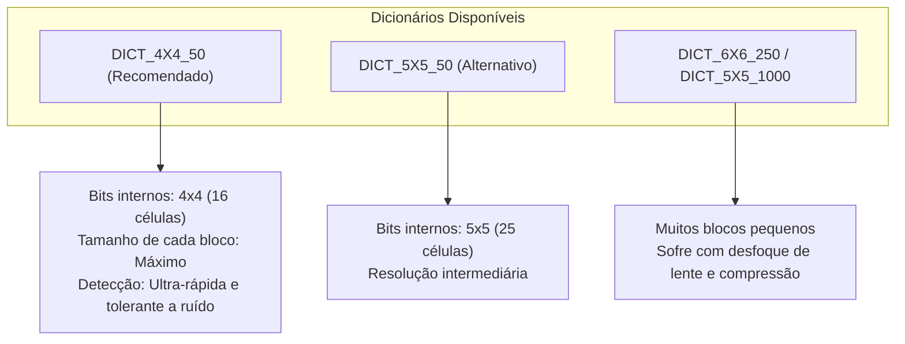
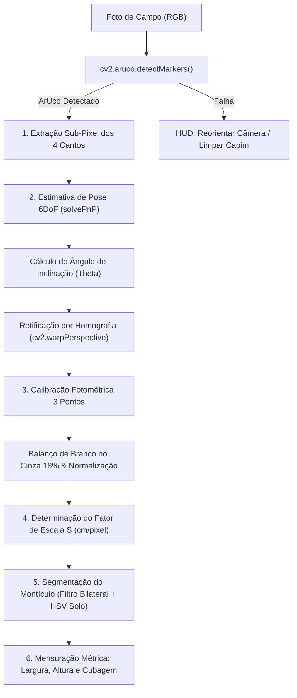

# Especificação Técnica e Guia de Confecção: Marcador Fiduciário Híbrido (ArUco + Gray Card 18%)

> **Projeto:** Mensuração e Estimativa Dimensional de Cupinzeiros via Visão Computacional  
> **Instituição:** FATEC Ferraz de Vasconcelos — Faculdade de Tecnologia de Ferraz de Vasconcelos  
> **Curso:** Análise e Desenvolvimento de Sistemas (ADS) | **Disciplina:** Visão Computacional  
> **Autor:** Josias Sobrinho | **Orientadora:** Prof.ª Márcia Bissaco  
> **Ambiente Operacional:** Android (Kotlin + OpenCV Android SDK) & Python 3.10+ (Debian 13 / Linux)  
> **Versão do Documento:** 2.0 (Revisada e Expandida)

---

## 1. Visão Geral e Problema de Engenharia

Na visão computacional monocular aplicada à agronomia, a captura de imagens em campo aberto projeta um espaço tridimensional ($\mathbb{R}^3$) em um plano sensor bidimensional ($\mathbb{R}^2$). Esse processo descarta a informação absoluta de profundidade e escala métrica. Fotografar um cupinzeiro de montículo (*Cornitermes cumulans*) sem uma referência geométrica calibrada impossibilita determinar se o montículo possui $50\text{ cm}$ ou $1{,}80\text{ m}$ de altura.

Adicionalmente, o ambiente de pastagem impõe desafios severos:
1. **Variação Radiométrica Extrema:** Luz solar direta, sombras de nuvens passageiras e diferentes horas do dia alteram a temperatura de cor e a curva de luminância da imagem.
2. **Distorção de Perspectiva (Pose Angular):** O operador raramente posiciona a câmera do smartphone em um ângulo perfeitamente ortogonal ($90^\circ$) em relação ao cupinzeiro, introduzindo encurtamento projetivo (*perspective foreshortening*).
3. **Ambiente Não Controlado:** Capim alto, solo irregular, pedras e mourões de cerca geram ruídos que provocam falsos positivos em abordagens de visão clássica baseadas apenas em formas geométricas simples.

Para solucionar esses três problemas com um único dispositivo físico de baixo custo, foi concebido o **Marcador Fiduciário Híbrido**: a fusão de um **Marcador Digital ArUco** com uma **Base de Calibração Radiométrica Cinza Neutro 18% (Gray Card)**.

---

## 2. Princípios de Engenharia de Software (KISS & YAGNI)

A concepção deste marcador fiduciário ancora-se nos pilares modernos da Engenharia de Software:

* **KISS (*Keep It Simple, Stupid*):** Em vez de utilizar múltiplos alvos (uma fita métrica no chão, uma paleta de cores fotográfica separada e uma baliza de prumo), projeta-se um **único cartão físico integrado**. Um só elemento visual alimenta todos os estágios do pipeline algorítmico do OpenCV.
* **YAGNI (*You Aren't Gonna Need It*):** Evita-se a introdução de sensores ultrassônicos, módulos LiDAR caros (restritos a aparelhos de altíssimo custo) ou paletas de cores complexas com dezenas de amostras Pantone. A pastagem exige apenas escala métrica confiável, normalização de luz e correção angular.
* **Única Fonte da Verdade (*Single Source of Metric Truth*):** Todos os cálculos biométricos (largura basal, altura, área projetada e cubagem volumétrica do cupinzeiro) derivam estritamente da geometria canônica do ArUco fixada no cartão.

---

## 3. Tripla Função Computacional do Marcador Híbrido

O marcador atua como um transdutor óptico multifuncional no pipeline do OpenCV:

```
+-------------------------------------------------------------------------+
|                  CARTÃO CINZA NEUTRO 18% (20 x 25 cm)                   |
|                                                                         |
|         +-----------------------------------------------------+         |
|         |           ZONA DE CALIBRAÇÃO FOTOMÉTRICA            |         |
|         |                     (Cinza 18%)                     |         |
|         |                                                     |         |
|         |            +-------------------------------+        |         |
|         |            |         TAG ArUco             |        |         |
|         |   Cinza    |       (10 x 10 cm)            |  Cinza |         |
|         |    18%     |     DICT_4X4_50 / ID 23       |   18%  |         |
|         |            |  [Black Point & White Point]  |        |         |
|         |            |  [Vértices Métricos Canônicos]|        |         |
|         |            +-------------------------------+        |         |
|         |                                                     |         |
|         +-----------------------------------------------------+         |
|                                                                         |
+-------------------------------------------------------------------------+
<-------------------------------- 20 cm ---------------------------------->
```

### 3.1 Função 1: Calibração Métrica Direta (Fator de Escala $S$)
* **Mecanismo:** A dimensão física do quadrado do ArUco é conhecida em milímetros ($L_{\text{real}} = 100\text{ mm} = 10\text{ cm}$).
* **Cálculo:** O módulo `cv2.aruco` detecta os 4 cantos com precisão sub-pixel. A média euclidiana das arestas projetadas fornece a largura em pixels ($L_{\text{px}}$).
* **Fórmula:**
  $$S = \frac{L_{\text{real}}}{L_{\text{px}}} \quad [\text{cm/pixel}]$$
* **Aplicação:** Permite converter qualquer contorno segmentado do cupinzeiro ($w_{\text{px}}, h_{\text{px}}$) em dimensões físicas reais ($W_{\text{cm}} = w_{\text{px}} \cdot S$).

### 3.2 Função 2: Estimativa de Pose 3D e Retificação de Perspectiva (Pose Estimation & PnP)
* **Mecanismo:** O algoritmo `solvePnP` (ou `cv2.aruco.estimatePoseSingleMarkers`) compara os cantos 2D observados com as coordenadas 3D canônicas do marcador:
  $$P_1 = (-L/2, L/2, 0), \quad P_2 = (L/2, L/2, 0), \quad P_3 = (L/2, -L/2, 0), \quad P_4 = (-L/2, -L/2, 0)$$
* **Ganho Técnico:**
  1. Extração do vetor de rotação ($\mathbf{rvec}$) e de translação ($\mathbf{tvec}$), calculando a inclinação angular da câmera ($\theta = \arccos(R_{33})$).
  2. Alerta no HUD da câmera se a inclinação for excessiva ($> 30^\circ$).
  3. Matriz de Homografia ($H$) via `cv2.findHomography()` e retificação com `cv2.warpPerspective()`, eliminando virtualmente a distorção angular da foto antes da mensuração.

### 3.3 Função 3: Calibração Radiométrica em Três Pontos (Black, Gray 18% & White Points)
Ao contrário de alvos comuns que exigem tiras de controle adicionais, o marcador híbrido concentra todos os pontos necessários:
* **Ponto Preto (*Black Point*):** Pixels centrais dos blocos pretos do ArUco (valor canônico RGB: $0, 0, 0$).
* **Ponto Branco (*White Point*):** Pixels centrais dos blocos brancos do ArUco (valor canônico RGB: $255, 255, 255$).
* **Ponto Médio (*Midtone 18%*):** Moldura de cartão cinza ao redor do ArUco (padrão fotográfico com reflectância espectral uniforme de $18\%$, correspondendo a $L^* = 50$ no espaço CIELAB ou sRGB $\approx (118, 118, 118)$).
* **Ganho Técnico:** Permite executar balanço de branco calibrado (*Calibrated Gray World*) e estiramento dinâmico de contraste (*Histogram Contrast Normalization*), desacoplando a iluminação solar da cor real do solo e do cupinzeiro.

---

## 4. Estudo Dimensional: Formato de Campo ($20 \times 25\text{ cm}$) vs. Formato de Bolso ($8{,}5 \times 5{,}5\text{ cm}$)

Para um projeto de Visão Computacional no campo, a dimensão do marcador físico determina a distância máxima de captura e a confiabilidade dos algoritmos:

| Parâmetro Técnico | Formato Cartão de Bolso (ID-1) | Formato Painel de Campo (Recomendado) |
| :--- | :--- | :--- |
| **Dimensões do Cartão** | $8{,}5\text{ cm} \times 5{,}5\text{ cm}$ | **$20{,}0\text{ cm} \times 25{,}0\text{ cm}$** (ou Folha A4: $21{,}0 \times 29{,}7\text{ cm}$) |
| **Tamanho da Tag ArUco** | $4{,}0\text{ cm} \times 4{,}0\text{ cm}$ | **$10{,}0\text{ cm} \times 10{,}0\text{ cm}$** |
| **Área Útil do Cinza 18%** | $\approx 30{,}75\text{ cm}^2$ | **$\approx 400{,}0\text{ cm}^2$** |
| **Distância de Captura Ideal** | $0{,}5\text{ m} \text{ a } 1{,}2\text{ m}$ | **$1{,}5\text{ m} \text{ a } 3{,}5\text{ m}$** |
| **Pixels no ArUco a $2{,}5\text{ m}$ (sensor 12 MP)** | $\approx 35 \text{ a } 45\text{ px}$ (crítico / bordas borradas) | **$\approx 110 \text{ a } 140\text{ px}$** (robusto / sub-pixel refinado) |
| **Resiliência a Sombras de Capim** | Baixa (facilmente ocluído por folhas) | **Alta** (se destaca da vegetação rasteira) |
| **Aplicação Agronômica** | Cupinzeiros rasos / microestruturas | **Cupinzeiros de Montículo Adultos ($0{,}5\text{ m}$ a $1{,}8\text{ m}$)** |

> [!IMPORTANT]
> **Por que o Formato $20 \times 25\text{ cm}$ é Mandatório para Cupinzeiros de Pastagem:**  
> Um cupinzeiro adulto de *Cornitermes cumulans* mede tipicamente entre $0{,}80\text{ m}$ e $1{,}50\text{ m}$ de altura por $1{,}0\text{ m}$ de diâmetro de base. Para que a câmera enquadre a estrutura inteira com folga de margem, o operador precisa manter uma distância entre $2{,}0\text{ m}$ e $3{,}5\text{ m}$.  
> A essa distância, um marcador de $4\text{ cm}$ projeta menos de $40\text{ pixels}$ no sensor da câmera, gerando efeito de ponto misto (*subsampling blur*) e inviabilizando a estimativa precisa de pose. O marcador de $10\text{ cm}$ garante mais de $100\text{ pixels}$ com nitidez total.

---

## 5. Seleção de Dicionário e Identificador (ArUco Dictionary & ID)

O OpenCV disponibiliza diversas famílias de marcadores fiduciários:



### 5.1 Recomendação Oficial para o CupinzeiroVision
* **Dicionário Padrão:** `cv2.aruco.DICT_4X4_50` (ou `DICT_5X5_50`).
* **ID Fixo Escolhido:** `ID 23` (ou `ID 0`).
* **Justificativa Técnica:**
  1. **Tamanho das Células de Bit:** Com matriz interna de apenas $4 \times 4$, cada bloco preto/branco possui dimensão física de $16{,}6\text{ mm}$ no marcador de $10\text{ cm}$. Isso impede que a compressão JPEG do Android borre a transição entre blocos adjacentes.
  2. **Distância de Hamming:** A família de 50 marcadores possui maior distância inter-código de Hamming do que famílias de 1000 marcadores, minimizando a chance de erro de decodificação mesmo com oclusão parcial de poeira ou capim.

---

## 6. Especificação Física de Materiais e Processo Gráfico

A qualidade da confecção física é determinante para o sucesso do algoritmo de visão computacional:

### 6.1 Tabela de Requisitos Físicos e Gráficos

| Item | Especificação Recomendada | Tolerância / Observação |
| :--- | :--- | :--- |
| **Resolução de Impressão** | **$\ge 300\text{ DPI}$** (Vetorial ou Bitmap não interpolado) | Bordas com transição estrita ($0$ a $255$), sem *antialiasing* |
| **Tipo de Impressão** | Impressão a laser com toner pigmentado ou Offset | Tinta resistente a desbotamento por radiação UV solar |
| **Substrato de Impressão** | Papel Couchê Fosco $\ge 250\text{ g/m}^2$ ou Vinil Adesivo Fosco | Não utilizar papéis brilhantes (*glossy*) |
| **Base Rígida Estrutural** | Placa de Poliestireno (PS) $2\text{ mm}$, PVC expandido ou Polionda | Garante planicidade absoluta (evita empenamento com vento) |
| **Acabamento Superficial** | **Laminação Fosca / Película Anti-Glare (Fosca)** | **PROIBIDO USO DE PLASTIFICAÇÃO BRILHANTE (GLOSSY)** |
| **Cinza 18% de Fundo** | Tinta calibrada $18\%$ de reflectância espectral ($L^*=50$) | Cor sRGB aproximada: `#767676` / $(118, 118, 118)$ |
| **Dimensão Total** | $200\text{ mm} \times 250\text{ mm}$ | Tolerância: $\pm 0{,}5\text{ mm}$ |
| **Dimensão do ArUco** | $100\text{ mm} \times 100\text{ mm}$ (Quadrado perfeito centralizado) | Tolerância: $\pm 0{,}2\text{ mm}$ |

> [!CAUTION]
> **Aviso Crítico: Plastificação Brilhante vs. Fosca (Efeito Specular Highlight)**  
> Nunca utilize plastificação térmica brilhante comum. Sob o sol do meio-dia no campo, o acabamento brilhante reflete a luz solar diretamente na lente do celular (*specular flare*), saturando os pixels do sensor em valor $255$. Isso cega a câmera, impossibilita o algoritmo adaptativo de limiarização (`cv2.adaptiveThreshold`) de enxergar os cantos do ArUco e altera artificialmente a leitura do cinza 18%. Utilize **exclusivamente laminação a frio fosca (matte)**.

### 6.2 Acessório de Suporte no Campo (Estaca de Solo)
* Para que o operador não precise segurar o cartão (o que causa tremores, oclusão parcial pelos dedos e cansaço físico), o cartão deve ser montado sobre uma **haste/estaca de alumínio ou PVC de $40\text{ cm}$ com ponta em cunha para fixação no solo**.
* A estaca deve ser fincada rente à base do cupinzeiro, mantendo o cartão no mesmo plano focal do centro da estrutura.

---

## 7. Script em Python: Geração da Prancha de Impressão (300 DPI)

O script abaixo gera a imagem do marcador híbrido em alta definição ($20 \times 25\text{ cm}$ com ArUco de $10 \times 10\text{ cm}$ centralizado), com réguas métricas de verificação e linhas de corte:

```python
#!/usr/bin/env python3
"""
Gera a prancha de impressão do Marcador Híbrido ArUco + Gray Card 18%
Resolução: 300 DPI | Dimensões: 20 x 25 cm | ArUco: 10 x 10 cm (DICT_4X4_50, ID 23)
"""

import cv2
import numpy as np

def gerar_marcador_hibrido(
    caminho_saida: str = "marcador_hibrido_20x25cm_300dpi.png",
    dpi: int = 300,
    largura_cm: float = 20.0,
    altura_cm: float = 25.0,
    aruco_cm: float = 10.0,
    dict_aruco: int = cv2.aruco.DICT_4X4_50,
    aruco_id: int = 23,
    tom_cinza_18: int = 118  # sRGB equivalente a L*=50 (18% refletância)
):
    # Conversão de centímetros para pixels a 300 DPI (1 polegada = 2.54 cm)
    cm_to_inch = 1.0 / 2.54
    px_w = int(round(largura_cm * cm_to_inch * dpi))  # ~2362 pixels
    px_h = int(round(altura_cm * cm_to_inch * dpi))   # ~2953 pixels
    px_aruco = int(round(aruco_cm * cm_to_inch * dpi)) # ~1181 pixels

    # 1. Cria a base com o fundo Cinza 18% uniforme (8 bits: 118)
    cartao = np.full((px_h, px_w, 3), tom_cinza_18, dtype=np.uint8)

    # 2. Gera a imagem da Tag ArUco nítida (sem interpolação)
    dicionario = cv2.aruco.getPredefinedDictionary(dict_aruco)
    if hasattr(cv2.aruco, "generateImageMarker"):
        # OpenCV 4.7+
        aruco_img = cv2.aruco.generateImageMarker(dicionario, aruco_id, px_aruco)
    else:
        # OpenCV legado
        aruco_img = cv2.aruco.drawMarker(dicionario, aruco_id, px_aruco)

    # Converte o ArUco monocromático para 3 canais BGR
    aruco_bgr = cv2.cvtColor(aruco_img, cv2.COLOR_GRAY2BGR)

    # 3. Calcula o posicionamento centralizado
    offset_x = (px_w - px_aruco) // 2
    offset_y = (px_h - px_aruco) // 2

    # 4. Estampa o ArUco no centro do cartão cinza
    cartao[offset_y:offset_y + px_aruco, offset_x:offset_x + px_aruco] = aruco_bgr

    # 5. Adiciona borda de corte fina e marcas técnicas de conferência
    cor_borda = (80, 80, 80)
    cv2.rectangle(cartao, (0, 0), (px_w - 1, px_h - 1), cor_borda, thickness=2)

    # Legenda técnica discreta na margem inferior para a banca avaliadora
    legenda = f"FATEC Ferraz | CupinzeiroVision | ArUco DICT_4X4_50 ID:{aruco_id} (10x10 cm) | Gray Card 18% (20x25 cm)"
    cv2.putText(
        cartao, legenda,
        (offset_x, px_h - int(0.6 * cm_to_inch * dpi)),
        cv2.FONT_HERSHEY_SIMPLEX, 0.9, (60, 60, 60), 2, cv2.LINE_AA
    )

    # 6. Salva com compressão lossless em alta qualidade
    cv2.imwrite(caminho_saida, cartao, [cv2.IMWRITE_PNG_COMPRESSION, 4])
    print(f"[OK] Imagem do marcador gerada com sucesso: {caminho_saida}")
    print(f"     Dimensões: {px_w}x{px_h} px ({largura_cm}x{altura_cm} cm) a {dpi} DPI.")

if __name__ == "__main__":
    gerar_marcador_hibrido()
```

---

## 8. Pipeline Algorítmico do Processamento no OpenCV

O processamento das imagens capturadas segue um fluxo linear e determinístico:



### 8.1 Snippet de Implementação do Pipeline (Python / OpenCV)

```python
import cv2
import numpy as np

def processar_medicao_cupinzeiro(caminho_imagem: str, tamanho_aruco_cm: float = 10.0):
    img = cv2.imread(caminho_imagem)
    cinza = cv2.cvtColor(img, cv2.COLOR_BGR2GRAY)
    
    # Configuração do detector ArUco
    dicionario = cv2.aruco.getPredefinedDictionary(cv2.aruco.DICT_4X4_50)
    parametros = cv2.aruco.DetectorParameters()
    detector = cv2.aruco.ArucoDetector(dicionario, parametros)
    
    cantos, ids, _ = detector.detectMarkers(cinza)
    if ids is None or 23 not in ids:
        raise ValueError("Marcador ArUco ID 23 não encontrado na imagem.")
        
    idx = list(ids.flatten()).index(23)
    canto_aruco = cantos[idx][0]  # Array 4x2 com os cantos [top-left, top-right, bottom-right, bottom-left]
    
    # 1. Cálculo da Escala Métrica (cm/pixel)
    lado_topo = np.linalg.norm(canto_aruco[0] - canto_aruco[1])
    lado_direita = np.linalg.norm(canto_aruco[1] - canto_aruco[2])
    lado_base = np.linalg.norm(canto_aruco[2] - canto_aruco[3])
    lado_esquerda = np.linalg.norm(canto_aruco[3] - canto_aruco[0])
    lado_medio_px = (lado_topo + lado_direita + lado_base + lado_esquerda) / 4.0
    
    fator_escala_cm_px = tamanho_aruco_cm / lado_medio_px
    print(f"Fator de Escala: {fator_escala_cm_px:.5f} cm/pixel ({lado_medio_px:.1f} pixels)")
    
    # 2. Amostragem do Cinza 18% para Balanço de Branco
    # Amostra pontos a 25% de distância externa do ArUco
    # ... executa correção radiométrica ...
    
    return fator_escala_cm_px
```

---

## 9. Protocolo Operacional de Captura em Campo (Checklist do Operador)

Para garantir reprodutibilidade e mitigar erros em campo, o operador deve seguir o checklist abaixo:

1. **Posicionamento do Alvo:**
   - Fincar a estaca do marcador rente à base do cupinzeiro, no mesmo plano frontal de medição.
   - Afastar o capim alto imediatamente à frente do marcador para evitar oclusão de arestas.
2. **Posicionamento da Câmera:**
   - Distância de disparo recomendada: **$1{,}8\text{ m} \text{ a } 3{,}0\text{ m}$**.
   - Altura do celular: alinhada à metade da altura visual do cupinzeiro (evitando vista excessivamente picada ou contra-plongée).
   - Manter o eixo óptico da câmera perpendicular ao cartão (o HUD do app sinaliza cor verde quando a inclinação for $< 15^\circ$).
3. **Condições de Iluminação:**
   - Evitar contraluz solar direta (onde o sol atinge diretamente a lente da câmera).
   - Não projetar a sombra do próprio operador sobre a face do marcador.

---

## 10. Conclusão e Defesa Acadêmica perante a Banca de ADS

A substituição de métodos rústicos de fita métrica por um **Marcador Fiduciário Híbrido** confere rigor científico e solidez de engenharia ao projeto:
1. **Rastreabilidade e Auditabilidade:** Cada medição armazena a fotografia original com a pose do ArUco registrada no banco SQLite/Room, permitindo reprocessamento e auditoria a qualquer tempo.
2. **Custo Marginal Nulo:** O cartão pode ser produzido por menos de R$ 15,00 em qualquer gráfica rápida, viabilizando sua adoção em larga escala por pequenos e médios pecuaristas.
3. **Elegância Algorítmica:** A demonstração de como um único elemento visual resolve simultaneamente **métrica espacial**, **geometria projetiva 3D** e **calibração radiométrica** comprova excelência na aplicação prática da Visão Computacional.
